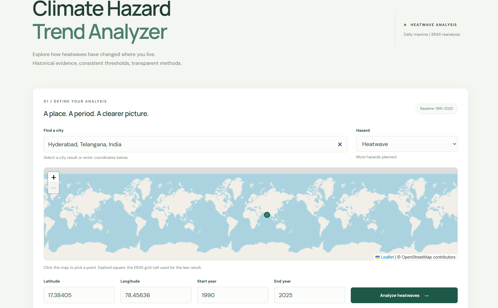
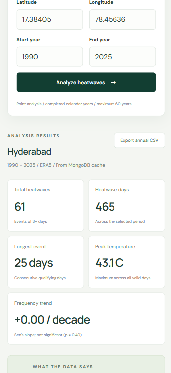
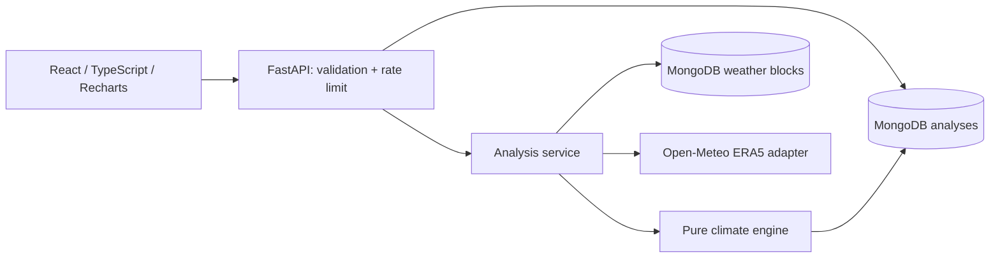

# Climate Hazard Trend Analyzer

A React + FastAPI application for exploring historical heatwave frequency, duration and intensity at a selected location. It uses real Open-Meteo ERA5 reanalysis, a fixed regional percentile baseline, and MongoDB for raw weather and processed-result caching.

**Scope:** Heatwaves only. Search a city or enter latitude/longitude. City names resolve to a representative point; the result is for an ERA5 grid cell, not a city-wide or state-wide spatial average.

**Live demo:** https://climate-hazard-analyzer-8zzq.onrender.com (Render free tier: the first request after idle can take ~50 s to wake the service)

## Screenshots

| Desktop | Mobile |
| --- | --- |
|  |  |

## Architecture



The browser calls only `/api/v1`. Vite proxies to FastAPI during development; nginx proxies in Compose. A root Dockerfile also bundles the React build into FastAPI for a single web-service deployment with external MongoDB. Analysis computation runs in a threadpool so it does not block the async HTTP/database loop.

## Technology choices

- React, TypeScript and Vite: a small, typed client without an unnecessary application server.
- Recharts: interactive annual plots, with accessible tables containing exact data.
- FastAPI/Pydantic: explicit validation, async I/O, generated API documentation.
- NumPy: percentile, ordinary least squares and Mann-Kendall written out in a few readable lines; pandas/scipy are unnecessary for one daily series per request.
- Leaflet (plain, no wrapper): click-to-pick map with OpenStreetMap tiles, lazy-loaded so it does not slow first paint.
- PyMongo async driver: direct MongoDB operations without an ORM or deprecated Motor dependency.
- MongoDB: document-shaped analysis responses, reusable weather blocks, unique indexes and TTL retention.

## Quick start: Docker

Requirements: Docker with the Compose plugin and outbound HTTPS access to Open-Meteo.

```sh
cp .env.example .env
# PowerShell alternative: Copy-Item .env.example .env
docker compose up --build -d
```

Open http://localhost:8080. API docs: http://localhost:8000/docs. The first analysis downloads the baseline plus selected historical blocks and can take a few minutes. Later requests reuse MongoDB. `docker compose down` stops the services and preserves cached data in the named volume.

The included unauthenticated MongoDB is for local development, published only on host loopback. Use authenticated TLS-enabled MongoDB for hosted deployments.

## Local development

Requirements: Python 3.12, Node 22, MongoDB 8 (or the Compose `mongo` service).

```sh
docker compose up -d mongo
python -m venv .venv
# POSIX:
. .venv/bin/activate
# PowerShell:
# .\.venv\Scripts\Activate.ps1
pip install -r backend/requirements.txt
cd backend
uvicorn app.main:app --reload
```

The default MongoDB URI is `mongodb://localhost:27017`. In another terminal:

```sh
cd frontend
npm ci
npm run dev
```

Open http://localhost:5173. For custom backend settings, create `backend/.env` or export environment variables. The repository-root `.env` is read by Compose, not by a backend started from its own directory.

## Environment variables

| Variable | Default | Purpose |
| --- | --- | --- |
| `MONGO_URI` | `mongodb://localhost:27017` | MongoDB connection string; keep credentials private |
| `MONGO_DATABASE` | `climate` | Database name |
| `CORS_ORIGINS` | localhost ports 5173, 8080 | Comma-separated permitted browser origins; empty for same-origin only |
| `CACHE_TTL_DAYS` | `30` | Raw and processed cache freshness |
| `RATE_LIMIT_PER_MINUTE` | `20` | Per-client analysis requests per minute, per process |
| `SEARCH_RATE_LIMIT_PER_MINUTE` | `60` | Separate per-client city-search budget, so typing cannot block analysis |
| `TRUSTED_PROXY_HOPS` | `0` | Reverse proxies in front of the app. The client is the address this many entries from the right of `X-Forwarded-For`; left-hand entries are client-supplied and ignored. `1` for Compose (nginx); see limitations for Render |
| `PORT` | `8000` | Root Dockerfile HTTP port |
| `FORWARDED_ALLOW_IPS` | Uvicorn default: loopback | Trusted proxy addresses; see security notes |
| `TEST_MONGO_URI` | unset | Enables opt-in real MongoDB integration tests |

No provider API key is needed for the public non-commercial endpoint. Check provider terms and quotas before commercial use; paid-provider support is not implemented.

## Data source

[Open-Meteo Historical Weather API](https://open-meteo.com/en/docs/historical-weather-api), explicitly selecting **ERA5**, `temperature_2m_max`, Celsius, local timezone (`auto`). ERA5 has approximately 0.25-degree resolution and represents reanalysis estimates, not a local weather station. Using a single model prevents multi-model transitions from masquerading as climate changes. Location search uses the [Open-Meteo Geocoding API](https://open-meteo.com/en/docs/geocoding-api).

Attribution appears in the app and JSON: Open-Meteo; Copernicus/ECMWF ERA5. Provider/model/grid coordinates/timezone are recorded in the response.

## Heatwave methodology

1. Fetch daily maximum temperatures for the point, including the fixed **1991-2020** reference period. This is a standard 30-year reference window ([WMO](https://wmo.int/media/news/updated-30-year-reference-period-reflects-changing-climate)); the app's heatwave indicator is its own explicit implementation, not a WMO-certified index.
2. Require at least 95% valid observations in **every baseline year**. Otherwise return 422 rather than inventing a threshold.
3. Calculate the pooled baseline 95th percentile with NumPy's `method="linear"` (index `(n-1)*0.95`, interpolated between neighboring sorted observations). This statistical interpolation does not interpolate missing weather observations.
4. Detect runs of **at least three consecutive calendar days strictly above** that threshold. Equality does not qualify. Any missing, invalid or non-hot day breaks the run.
5. Store start/end dates, duration, event peak, and mean/max temperature excess above threshold. Calculations retain full precision; the dashboard rounds only for presentation.
6. Count each event once, in its start year. Assign heatwave days and daily excess intensities to the calendar year in which they occur. Annual mean/max event duration uses the start year. The summary peak is the maximum of **all valid selected observations**, even if it falls outside a heatwave.

The threshold stays fixed when the analysis range changes. A pooled annual threshold emphasizes the hottest season; a seasonal/calendar-day percentile would answer a different question. Events at selected-period boundaries can be truncated; the app explicitly warns about this. Event discovery does not merge hot days across missing observations or across non-adjacent dates.

### Honest trend reporting

Annual heatwave counts at one point are small integers (often 0-3), so a headline like "heatwaves increased 400%" can come from 1 event versus 5. The app avoids that:

- **In plain terms:** Mann-Kendall compares every pair of years and asks "is the later year higher or lower?". If later years are consistently higher (or lower) more often than chance would allow, the trend is called significant. Sen's slope is the median of the year-to-year slopes across all pairs, so it gives a typical change in events per decade that one freak year cannot distort.
- **Significance:** a two-sided **Mann-Kendall** test (tie-corrected, p < 0.05) with **Sen's slope** in events/decade, over at least ten well-covered years. Both are rank-based, so one extreme year cannot drive the result. The test assumes independent years; serial correlation would make p-values optimistic, and no pre-whitening is applied.
- **Insight text** leads with absolute numbers: mean events/year in the **first five versus last five calendar years** (non-overlapping, all ten years must pass coverage), followed by the Mann-Kendall verdict. Example from real data (Hyderabad, 1990-2025): "Heatwaves averaged 1.2 events/year in 1990-1994 and 0.4 in 2021-2025. Mann-Kendall finds no statistically significant trend (p = 0.50)". A bare percentage here would read as "down 66.7%", which is six events versus two.
- **Percentages** appear in the insight only when the trend is significant *and* the early window averages at least one event a year. Below that, `percent_change` is `null` in the API.
- Ordinary least squares (events/decade, R-squared) is still returned and drawn as a dashed visual guide, but it is not used for claims: count data violates its normal-residual assumption.
- Trailing five-year event mean uses five actual calendar years, all with >=95% coverage. No shorter early-window averages are shown.
- Duration and total heatwave-day regression slopes are also returned. Duration excludes no-event years (undefined duration), so it describes years with events rather than treating absence as a zero-day event.
- Coverage below 95% excludes a year from trend estimation; observed annual counts remain available. Even 95% coverage can miss extremes or split events. This is descriptive analysis, not causal attribution, a health warning, or proof of statistical significance.

## Data cleaning

The engine reindexes onto the full requested calendar, including leap days. Nulls, nonnumeric values, booleans, infinities and NaNs become missing. Values outside -90 to 65 Celsius are rejected as physically implausible. Plausible regional extremes are retained rather than clipped by an arbitrary z-score. Identical duplicate dates collapse; conflicting duplicates become missing. Invalid dates and out-of-period observations are reported and ignored. There is **no temporal interpolation**.

Malformed provider arrays, unexpected units, missing grid/timezone metadata and failed HTTP requests produce safe errors. Current/partial calendar years are rejected by the public API; the engine still handles partial-year input explicitly for independent use. An all-missing requested period is rejected. Quality metadata reports requested/valid/missing days, coverage, duplicates, conflicts, rejected values, ignored dates, interpolation count and warnings, separately for the analysis and baseline.

## Caching and MongoDB schema

Two collections use documents shaped as `{key, created_at, expires_at, payload}`:

- `weather`: reusable **decade blocks**, keyed by exact requested coordinates, block bounds, model, unit, timezone mode and schema version. The current decade ends at the last completed year. Raw daily values are stored with grid/timezone metadata, then cleaned by the versioned engine; this preserves an audit trail of noisy input.
- `analyses`: processed JSON, keyed by coordinates, full-year range, hazard, baseline, model, timezone, units and algorithm version.

Keys are SHA-256 of canonical sorted JSON. Each collection has a unique key index and an expiry TTL index. Reads independently check `expires_at`, because MongoDB TTL deletion is asynchronous. Cold results are persisted and read back before returning. Freshness defaults to 30 days because historical reanalysis may be revised. Changing the algorithm invalidates processed results while retaining reusable weather blocks. Coordinates are rounded to 0.01 degrees (~1 km) on input and echoed back in `region`; the ERA5 grid is ~0.25 degrees, so this only matters on a cell boundary, and it stops near-identical points from fragmenting the cache or forcing new downloads.

Bounded lock arrays coalesce duplicate requests/raw block downloads within one process. Four analyses and three upstream HTTP requests can run concurrently. Across multiple processes/replicas, unique MongoDB indexes protect document integrity but do not provide a distributed download lock.

## API

| Endpoint | Behavior |
| --- | --- |
| `GET /api/v1/health` | Process liveness/version |
| `GET /api/v1/ready` | MongoDB readiness |
| `GET /api/v1/regions/search?q=hyderabad` | Up to eight city candidates |
| `POST /api/v1/analyze` | Persist/read analysis and return JSON |
| `GET /docs` | Interactive OpenAPI documentation |

```json
{"latitude":17.385,"longitude":78.4867,"start_year":1990,"end_year":2025,"hazard":"heatwave"}
```

Response keys: `region`, `period`, `threshold`, `summary`, `annual_metrics`, `events`, `trend`, `data_quality`, `baseline_data_quality`, `source`, `algorithm_version`, `cache`.

Errors: 422 invalid input/insufficient baseline (validation errors list field and message, never the raw input); 413 oversized body; 429 rate limit (with Retry-After); 502 provider failure/malformed response; 503 storage unavailable; 504 overall analysis deadline. Unexpected errors return a generic 500 and are logged server-side.

## Security and performance

- Strict Pydantic schema, unknown fields forbidden, finite coordinates with valid ranges, integer years from 1940 through the last completed year, maximum 60 years. Search strings are bounded and reject control/markup characters.
- Fixed HTTPS upstream URLs; user input cannot select an arbitrary host. No browser-to-weather requests, redirects or provider secrets.
- 5-second connect/30-second request timeout; at most three attempts for network failures, 429 and 5xx, with bounded exponential backoff. Other 4xx responses are not retried. Overall analysis deadline: 240 seconds.
- 4 KiB request limit, including streamed bodies, and a bounded per-client rate-limit map. Limiter is process-local; use one worker or a shared gateway/Redis limiter for replicas.
- Explicit CORS, React's default escaped text rendering, frontend CSP, anti-framing and content-type protections. No HTML injection.
- Containers run as non-root. Local Mongo/API ports bind to host loopback; only the frontend is externally bound in Compose.
- Compose trusts its nginx proxy, which **overwrites** forwarded client-address headers. Backend HTTP access is loopback/internal only. For another host, configure only its actual trusted proxies before enabling forwarded headers; do not expose a backend that blindly trusts arbitrary forwarded headers. Rate limiting otherwise sees the proxy's address.
- No committed secrets. Mongo startup/index creation is fail-fast; no in-memory production fallback conceals missing persistence.

## Tests

```sh
cd backend
python -m pytest -q
# POSIX real Mongo integration:
TEST_MONGO_URI=mongodb://localhost:27017 python -m pytest -q
# PowerShell:
# $env:TEST_MONGO_URI='mongodb://localhost:27017'; python -m pytest -q
cd ../frontend
npm test
npm run build
npm audit
```

Backend tests (54, including opt-in MongoDB integration) cover 2/3/4+/10-day runs, values equal to and just above the threshold, two separate events, missing days and sparse dates, leap years, cross-year events, partial and single-year periods, physical-range limits, duplicates and conflicts, baseline coverage, Mann-Kendall known values and outlier robustness, suppression of percentages from a near-zero base, invalid and overflowing inputs, upstream failures/retries, request limits and caching. Frontend tests (6) cover form defaults, invalid range, API error/retry state, trend significance labelling and CSV formula-injection safety. CI runs all of the above on every push. Lint: `ruff check backend` (config in `backend/ruff.toml`).

## Deployment

The live demo runs as a **single Docker web service on Render** (free tier) with **MongoDB Atlas** (free M0 cluster):

1. Atlas: create a database user with `readWrite` on the `climate` database, and allow network access from Render (Render's free tier has no static IP, so this means `0.0.0.0/0`, protected by the user's password).
2. Render: New Web Service from this repository, runtime Docker (root `Dockerfile`), instance type Free, health check path `/api/v1/ready`.
3. Environment: `MONGO_URI` (Atlas connection string, kept as a Render secret), `MONGO_DATABASE=climate`, `TRUSTED_PROXY_HOPS`.

The root Dockerfile builds the React app and serves it from FastAPI at `/`, so the UI and `/api` share one origin and no CORS configuration is needed. `render.yaml` describes the same service as a Blueprint.

Docker Compose (see Quick start) is the alternative for a single host: put the frontend behind TLS and use an authenticated MongoDB with backups. Do not publish the development MongoDB port.

Cold analyses of a new location download several decades of data and can take a minute; completed blocks stay cached, so a retry is fast. For heavier use, analysis would move to a background job queue with polling rather than longer HTTP timeouts.

## Assumptions, limitations and next improvements

- Point/grid-cell analysis only; no polygon/state area weighting or bounding-box averaging. City selection satisfies the location workflow without implying spatial averaging.
- The fixed 1991-2020 reference overlaps some historical analysis periods and is not a preindustrial reference. Changing the baseline is a deliberate algorithm/version change.
- Screening thresholds, pooled seasonality, 95% coverage tolerance, boundary truncation and reanalysis resolution limit interpretation. There is no uncertainty interval or autocorrelation-adjusted significance test.
- No authentication is provided for this public read/compute dashboard. Public deployments need shared quotas, monitoring and a cost budget.
- On the live Render deployment, client-IP detection behind Render's proxy chain is not yet tuned, so per-client rate limiting is not effective there; it is verified locally and in Docker Compose behind nginx (tests cover spoofed `X-Forwarded-For`). The fix is to confirm the header layout Render sends and set `TRUSTED_PROXY_HOPS` to match.
- Rate limits are in-process memory: they reset on restart and are per replica. `TRUSTED_PROXY_HOPS` must match the real proxy chain; too low groups all users under the proxy address, too high lets clients spoof their identity.
- Upstream terms/quotas and revisions can change; caching reduces but does not eliminate dependence on the provider.
- Future: calendar-day (seasonal) percentile threshold, autocorrelation-corrected Mann-Kendall, sensitivity analysis to the 95th/3-day choices, async job queue for cold requests, Redis-backed rate limits, bounding-box/polygon averaging, event CSV and PDF report. Map selection, annual CSV export, linear regression and Mann-Kendall are included.

## AI tools used

I used AI coding assistants throughout this project. OpenAI Codex generated much of the initial implementation, tests and documentation from my prompts. Claude Code reviewed the result against the brief: it caught a misleading percentage-based insight, an input-validation crash and caching and rate-limiting issues, and helped add the Mann-Kendall test, the map picker and more edge-case tests.

I chose which suggestions to keep, made the calls on the heatwave definition and how trends are reported, ran and checked the tests, compared results against real data, and set up and debugged the Render and MongoDB Atlas deployment myself. I can walk through and change any part of the code.
